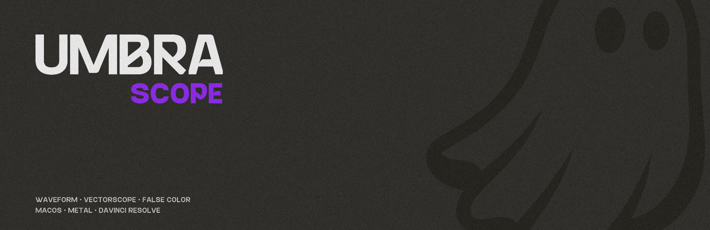
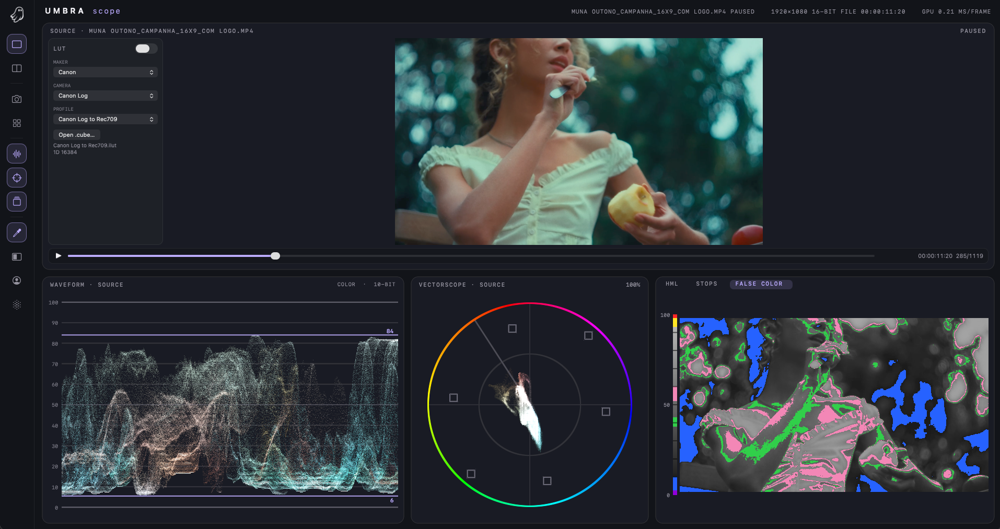
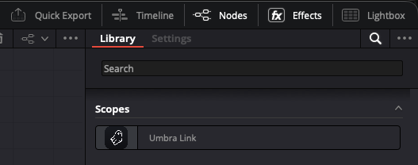
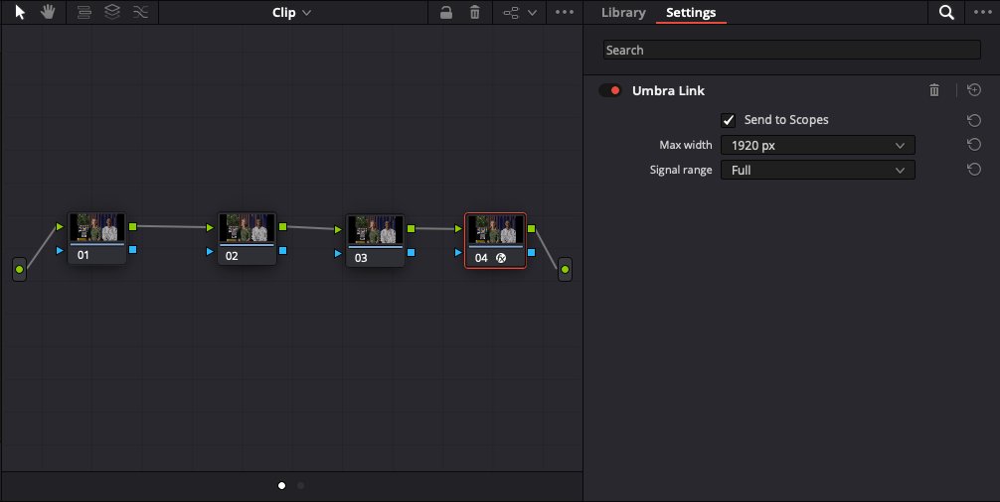
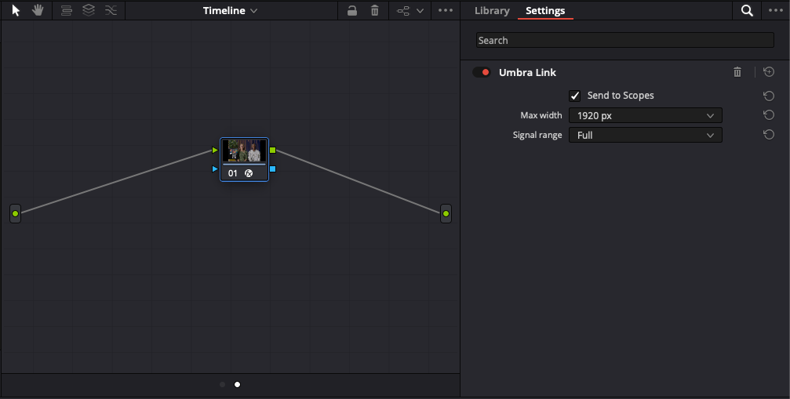
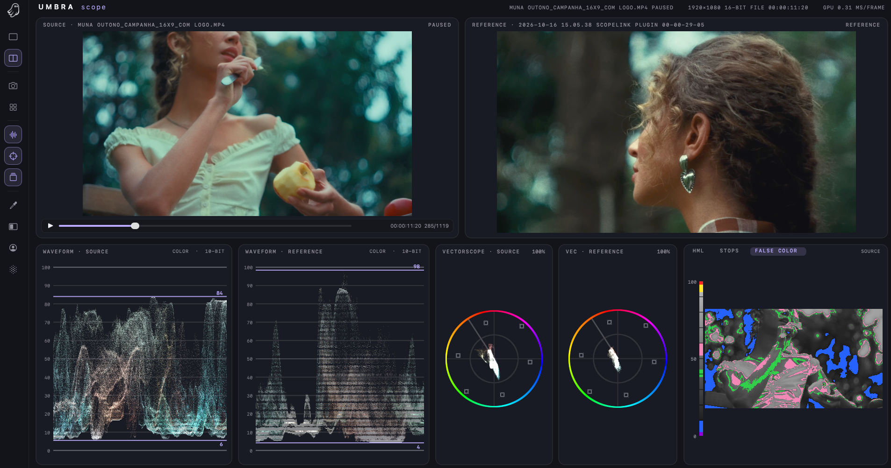
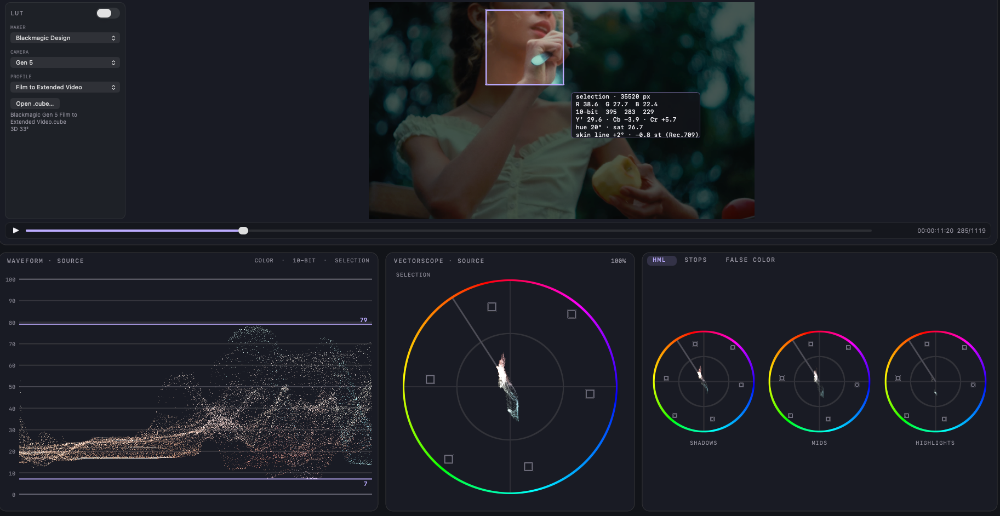
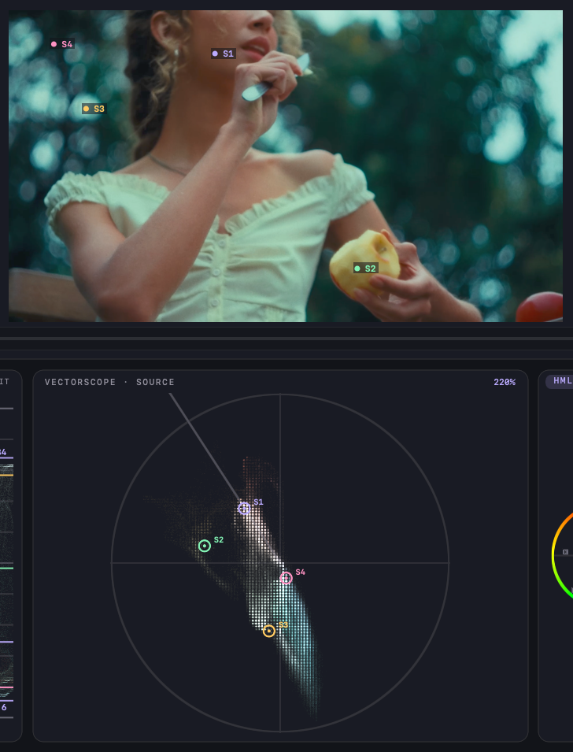
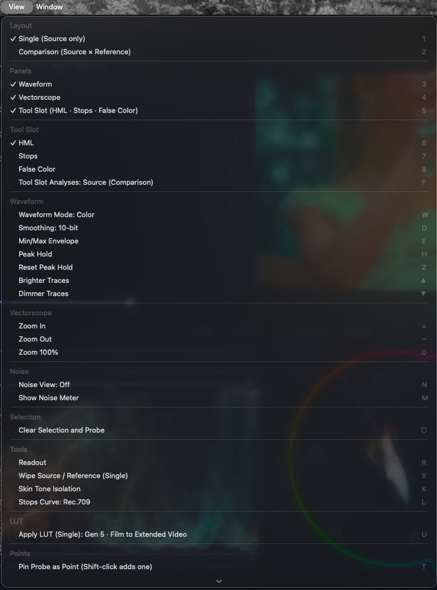
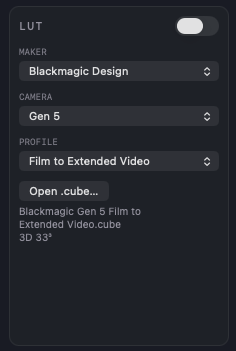

<p align="center">
  
</p>

<h3 align="center">SCOPES DE VÍDEO PARA MAC OS.<br>OPEN SOURCE</h3>

<p align="center">
  <a href="../../releases/latest"><b>BAIXAR</b></a> &nbsp;·&nbsp;
  <a href="#download-e-instalação">INSTALAR</a> &nbsp;·&nbsp;
  <a href="#build-e-uso">COMPILAR</a> &nbsp;·&nbsp;
  <a href="#atalhos-e-menus">ATALHOS</a>
</p>

<p align="center">
  
</p>

App de scopes de vídeo para macOS (Swift + Metal).

Capacidade de ler arquio local, entrada externa de vídeo, e com plugin OFX **Umbra Link** que envia a imagem direto do DaVinci
Resolve. Shaders, plugin e protocolo próprios.

| | |
|---|---|
| **Waveform.** | Color, RGB e Luma. Uma linha por código de 10 bits. |
| **Vectorscope.** | Zoom de 100% a 1600% e **Show 2x Zoom** (sinal dobrado, graticule na mesma escala). Anel de matiz e linha de tom de pele. |
| **False Color, Stops, HML.** | Exposição em stops por curva de câmera (Canon Log 3, S-Log3, LogC3, BMD Film). |
| **Reference.** | Compare com um snapshot: dois scopes lado a lado, ou wipe. |
| **Fontes.** | DaVinci Resolve (Umbra Link), placa de captura, vídeo, BRAW e RAW de foto. |
| **Sem rede.** | Operação totalmente local e offline |

<sub>SÃO PAULO · BRASIL &nbsp;—&nbsp; Apple Silicon · macOS 14+</sub>

## Download e instalação

Requer Mac com Apple Silicon (M1 ou mais novo) e macOS 14 Sonoma ou mais novo.

1. **Baixe** `UmbraScope-<versão>.dmg` na página de [Releases](../../releases/latest), abra o DMG e arraste
   **Umbra Scope** para **Applications**.
2. **Libere na primeira abertura.** O app é gratuito e não é notarizado pela Apple, então o macOS avisa que "não pôde
   verificar" o app. Dê dois cliques, clique em "Concluído", abra *Ajustes do Sistema → Privacidade e Segurança*, clique em
   **Abrir Mesmo Assim** e confirme com a senha. Ou, no Terminal:
   `xattr -dr com.apple.quarantine "/Applications/Umbra Scope.app"`
3. **Instale o plugin do DaVinci Resolve.** O plugin OFX **Umbra Link** já vem dentro do app: se o Resolve estiver
   instalado, o Umbra Scope oferece instalá-lo na primeira abertura (pede a senha de administrador); também está em
   *Umbra Scope → Install DaVinci Resolve Plugin…*. Reinicie o Resolve e, na página Color, arraste o efeito
   **Umbra Link** (OpenFX) para um nó.

O DMG traz também o guia `LEIA-ME · READ ME.txt` (português e inglês). Para publicar uma versão: `tools/release.sh`.

## Build e uso

```bash
# uma vez: dependências em third_party/ (libzmq estática universal + OpenFX 1.4; LibRaw é compilado pelo build.sh)
git clone --depth 1 https://github.com/LibRaw/LibRaw.git third_party/LibRaw
git clone --depth 1 --branch v4.3.5 https://github.com/zeromq/libzmq.git third_party/libzmq
git clone --depth 1 --branch OFX_Release_1_4_TAG https://github.com/AcademySoftwareFoundation/openfx.git third_party/openfx
cmake -S third_party/libzmq -B third_party/libzmq/build -DCMAKE_BUILD_TYPE=Release -DBUILD_SHARED=OFF \
  -DBUILD_TESTS=OFF -DWITH_LIBSODIUM=OFF -DENABLE_CURVE=OFF -DWITH_DOCS=OFF -DCMAKE_POLICY_VERSION_MINIMUM=3.5 \
  -DCMAKE_OSX_ARCHITECTURES="arm64;x86_64" -DCMAKE_OSX_DEPLOYMENT_TARGET=12.0 -DCMAKE_POSITION_INDEPENDENT_CODE=ON \
  -DCMAKE_C_FLAGS="-ffile-prefix-map=$PWD=." -DCMAKE_CXX_FLAGS="-ffile-prefix-map=$PWD=."   # sem caminhos do usuário
cmake --build third_party/libzmq/build -j

./build.sh                    # app: "build/Umbra Scope.app" (compila o FFmpeg na 1ª vez)
tools/make_dmg.sh             # dist/UmbraScope-<versão>.dmg
Plugin/build_plugin.sh        # plugin OFX: build/UmbraLink.ofx.bundle
Plugin/install_plugin.sh      # copia para /Library/OFX/Plugins (pede senha); reinicie o Resolve
open "build/Umbra Scope.app"
```

No Resolve: página Color → OpenFX → **Scopes → Umbra Link**, arraste para o último nó (ou um nó serial no fim).
A imagem passa sem alteração; o app mostra o que entra no nó.

<p align="center">
  
</p>

**Opção 1 · no clip:** arraste o **Umbra Link** para o último nó do clipe.

<p align="center">
  
</p>

**Opção 2 · na timeline:** ou aplique o link direto na timeline, para valer para todos os clipes.

<p align="center">
  
</p>

### Janela
Dois layouts (menu View → Layout; o app reabre no último usado):
- **Single** (`1`): só o Source — imagem em cima na largura toda, e embaixo Waveform, Vectorscope e um **slot de ferramenta
  com abas** (HML · Stops · False Color; clique na aba ou `6`/`7`/`8`). Só a aba visível é calculada.
  `S` continua salvando snapshots na galeria; carregar uma imagem como Reference (galeria, arrastar, Open Image)
  muda sozinho para Comparison.

  

- **Comparison** (`2`): duas colunas lado a lado — **Source** (ao vivo) e **Reference** (snapshot),
  cada uma com seu waveform e seu vectorscope, mais o mesmo slot de ferramenta com abas; `F` escolhe se ele analisa o
  Source ou a Reference (aparece à direita das abas, abreviado para Src/Ref quando falta espaço).

  

**Painéis** (View → Panels): `3` Waveform · `4` Vectorscope · `5` slot de ferramenta ligam
e desligam cada card da fileira de baixo; os que ficam dividem a largura (cada um mantém o seu peso para quando voltar)
e, com todos desligados, a imagem ocupa a altura toda. Painéis e aba lembrados entre aberturas (`hiddenPanels.v2`,
`toolTab`); para testes, `--hide-panels 0,2` (0 waveform, 1 vectorscope, 2 slot; não salva) e `--tool-tab N`.
**Rail** (roxo = ligado): layouts (Single, Comparison) · snapshot e galeria · painéis (Waveform, Vectorscope, slot de
ferramenta) · ferramentas da imagem (Readout, Wipe, Skin, Noise meter). Cada botão tem a tecla no tooltip.
Cada layout guarda as próprias larguras de coluna. Embaixo, uma linha de status com formato/timecode do sinal.

**Larguras ajustáveis**: arraste as divisórias entre os painéis da fileira de baixo (waveforms, vectorscopes, False
Color) para mudar a largura de cada um; o cursor vira ↔ sobre elas. O vectorscope fica sempre quadrado e centralizado na
coluna. Duplo clique numa divisória volta ao layout padrão. As larguras são lembradas entre aberturas
(`UserDefaults`, chave `bottomColumnWeights`). Para testes: `--check-divider-drag [divisória] [pontos]`.

### Análise por área
Selecione uma área da imagem e os scopes passam a medir só ela.

- **Caixa de seleção**: arraste um retângulo sobre a imagem e waveform, vectorscope e picos analisam apenas aquela
  caixa; o resto da imagem fica escurecido e um chip mostra os valores médios da área (R/G/B, 10 bits, Y′, Cb/Cr,
  matiz, saturação e desvio da linha de pele).

<p align="center">
  
</p>

- **Vectorscope por pontos**: com Shift-clique, marque até quatro pontos na imagem (S1–S4). Cada ponto ganha a sua
  cor e aparece no vectorscope exatamente onde essa cor cai, com o mesmo rótulo.

<p align="center">
  
</p>

### Atalhos e menus
<p align="center">
  
</p>

O menu **View** lista todos os atalhos de teclado (agrupados: Waveform, Vectorscope, False Color, Selection,
Snapshots, Playback), cada um com a tecla à direita, e os gestos de mouse/trackpad. Menu e teclado vêm da mesma
tabela (`viewCommands` em `main.swift`), então não divergem. `--check-view-menu` imprime o menu e testa uma tecla.
- **Source**: `⌘1` plugin Umbra Link (Resolve) · `⌘2` **placa de captura / câmera** (UVC, ex.: HDMI→USB MS2109;
  o submenu Source → Capture Devices escolhe entre os aparelhos, placas externas primeiro; pede acesso à Câmera na
  primeira vez; pega o maior formato e depois o maior frame rate — na MS2109, 1920×1080; o status mostra "no signal"
  se a imagem parar; para testes: `--capture-input`) · `⌘O` **arquivo do
  Finder** (vídeo ou imagem) no lugar do Resolve. Também dá para arrastar um arquivo do Finder para a imagem da
  esquerda (Source); vídeos sempre viram Source. Vídeo é lido em half float de 16 bits (ProRes/HEVC de 10 bits
  mantêm a precisão; conferido com uma rampa ProRes 422 HQ 10-bit), em loop, com play/pause (`Space`) e quadro a
  quadro (`,` e `.`). **Barra do player** embaixo da imagem do Source (só para arquivos com mais de um quadro):
  play/pause, uma barra para arrastar até o quadro (arrastar pausa; ao soltar volta a tocar se estava tocando) e o
  timecode com quadro/total. Para testes: `--seek N`.
- **Snapshots**: `⌘S` ou `S` salva o frame ao vivo (PNG 16-bit em `~/Pictures/Umbra Scope Snapshots`) e o carrega na
  coluna Snapshot · `⇧⌘O` abre qualquer imagem · *Clear Snapshot* · *Show Snapshots Folder* · lista dos recentes.
  Imagens copiadas para a pasta (ou arrastadas para a janela) entram sozinhas na coluna Snapshot.
  Imagens são lidas como valores de código (sem decodificar sRGB), como o Resolve mede.
- **Waveform**: `W` alterna **Color** (posição pela luma, ponto na cor do próprio pixel; padrão), **RGB** (cada canal
  no seu nível e na sua cor; cinzas somam branco) e **Luma**. Escala 0–100 à esquerda de cada waveform.
- **Vectorscope**: zoom independente em cada um — rolagem ou pinça sobre ele, `+`/`−` (o que estiver sob o ponteiro,
  ou os dois), `0` ou duplo clique volta a 100%. O % aparece no canto superior direito. Zoom refaz o scatter na nova
  escala (mais detalhe, não pixels maiores), de 100% a 1600%. Anel de matiz no círculo de 100% de saturação.
- **Show 2x Zoom** (`V`, ou a caixa logo abaixo do título de cada vectorscope): desenha a crominância com o **dobro do
  valor** — uma cor que chegava a X passa a chegar a 2X, como a opção do vectorscope do Resolve. Não é o zoom do mouse:
  o graticule, o anel de matiz, a skin line e a percentagem de zoom ficam na escala normal, então a leitura continua
  contra as mesmas referências. Pontos fixados (T1…T4) e regiões marcadas acompanham o sinal dobrado. Vale para o Source
  e o Reference. Para testes: `--vec2x`.
- **Galeria**: faixa no topo da janela com todas as imagens da pasta `~/Pictures/Umbra Scope Snapshots` (a mais nova
  primeiro). Clique carrega na coluna Snapshot; `←`/`→` passam para a anterior/próxima; botão direito: Reveal in
  Finder / Move to Trash. Botões *Snapshot* (= `S`) e *Folder* (abre a pasta no Finder). A pasta é a galeria: o que
  for copiado ou apagado pelo Finder aparece/some na hora (e imagens novas entram sozinhas na coluna Snapshot).
  `G` (ou View → Show Gallery) mostra/esconde a faixa; o app abre com ela fechada.
- **Seleção**: arraste sobre a imagem (ao vivo ou snapshot) para limitar waveform, vectorscope e picos àquela área;
  com `⌥` a forma é uma elipse. Cada sinal tem a sua seleção. Clique sem arrastar ou `Esc` limpa (a do quadro sob
  o ponteiro, ou as duas). Fora da seleção a imagem fica escurecida; no waveform as colunas da seleção ocupam toda a
  largura, e o ganho dos traços é compensado pelo tamanho da área. Para testes: `--select-live x,y,w,h[,ellipse]` e
  `--select-snapshot …` (frações da imagem).
- **Pontos** (Shift-clique adiciona/remove, `T` fixa a sonda, `⌫` limpa): até **4 pontos no Source (S1–S4) e 4 na
  Reference (R1–R4)**, cada par com a sua cor. São sondas fixas de 5×5 px: o valor é medido de novo a cada frame, então,
  enquanto você corrige o Source, a diferença para a Reference se atualiza. Na imagem, "● S1" / "● R1" marca cada
  ponto; em todos os scopes, Source em linha cheia e Reference tracejada (waveform: nível de luma, ou R/G/B no modo RGB;
  vectorscope: anel com ponto central / anel tracejado; Stops: linha na exposição). Uma tabela no canto do Source
  mostra, por par, os dois valores e **S − R**: R/G/B (%), ângulo no vectorscope e stops. No Single, os pontos da
  Reference aparecem do lado dela no wipe. As posições ficam salvas entre aberturas. Para testes: `--points "x,y;x,y"`,
  `--points-ref …`, `--check-shift-clicks`.
- **Duas sondas**: Source e Reference têm sondas e chips independentes — no Comparison, clique em cada imagem; no
  Single com wipe, clicar à direita da linha mede a Reference (chip "REFERENCE") e à esquerda o Source (chip
  "SOURCE"), cada chip preso ao seu lado. Arrastar continua selecionando no Source. Para testes: `--probe-ref x,y`,
  `--check-clicks`.
- **Marcar no scope → ver na imagem**: arraste um retângulo sobre o **waveform** ou o **vectorscope** e a imagem mostra
  quais pixels caem ali — esses ficam na cor (puxados levemente para o roxo), o resto vira cinza escuro. No waveform
  o retângulo vale para as colunas e a faixa de sinal marcadas (luma; no modo RGB, qualquer canal na faixa); no
  vectorscope, para a caixa de Cb/Cr. A marca fica guardada em valores de sinal, então continua certa ao mudar o zoom
  do vectorscope ou a seleção. Clique sem arrastar no scope ou `Esc` apaga. Vale para Source e Reference (cada uma
  com os seus scopes). Para testes: `--mark-wave x0,x1,lo,hi`, `--mark-vec cb0,cb1,cr0,cr1`, `--check-mark-drag wave|vec`.
- **Envelopes** (`E`): contorno de mínimo e máximo **por coluna** sobre o waveform — branco em Color/Luma, um por canal
  (vermelho, verde, azul) em RGB. Mostra até um único pixel fora da faixa, que o traço ponderado pode esconder.
  Respeita a seleção (as colunas da seleção ocupam a largura toda, como o traço). Valores exatos, sem a suavização.
- **Peak hold** (`H`): guarda o mínimo e o máximo de cada coluna ao longo do tempo, em âmbar tracejado, para ver se o
  sinal passou de um limite enquanto você olhava para outro lugar. `Z` (ou clicar em "↺ HOLD" no título do waveform)
  zera; também zera ao trocar de fonte, seleção, tamanho de frame ou LUT. Kernel `wave_envelope`: uma thread por
  coluna, buffers de mín./máx. desenhados pelo próprio shader do painel, com linhas de 1 px antisserrilhadas.
  Para testes: `--envelope`, `--peak-hold`.
- **Picos**: cada waveform tem duas linhas vermelhas com o valor (máximo em cima, mínimo embaixo).
  Luma nos modos Color/Luma, qualquer canal no modo RGB. Calculados na GPU (kernel `peaks`, redução por SIMD +
  atômicos) só quando o frame ou o modo muda; o valor exato, sem o espalhamento de ±½ código.
- **False Color**: aba do slot de ferramenta, com legenda. Zonas sobre a luma Rec.709: roxo < 2,5 % · azul 2,5–10 % · verde 38–43 % (cinza médio) ·
  rosa 52–60 % (pele) · amarelo 93–98 % · vermelho ≥ 98 %; o resto em cinza.
- `↑/↓` ganho dos traços · `espaço` pausa/toca (arquivo de vídeo).
- **10 bits**: do Resolve ao scope não há etapa abaixo de 10 bits (float no plugin → 16 bits no fio → half float na
  análise; picos e snapshots sem arredondar). O waveform tem 1127 linhas = 1024 para 0–100, uma por código de 10 bits
  (na tela, um código só ocupa um pixel inteiro se o painel tiver mais de ~1100 px de altura).
- **Suavização** (`D` ou View): 10-bit (padrão, ±½ código de 10 bits), 8-bit (±½ código de 8 bits, para clipes de
  8 bits não mostrarem listras) ou desligada (valores crus). Aparece no título do waveform. Os picos nunca são
  suavizados.

### LUT (layout Single)
<p align="center">
  
</p>

Painel à esquerda da imagem do Source: **Maker → Camera → Profile** com todos os LUTs que o DaVinci Resolve instala
(`/Library/Application Support/Blackmagic Design/DaVinci Resolve/LUT`, e a mesma pasta em `~/Library`), mais um botão
*Open .cube…* para qualquer arquivo. Os do Resolve vêm agrupados por fabricante (ARRI, Blackmagic Design por câmera,
Canon Log, DJI por drone/Zenmuse, Sony S-Log2/S-Log3, RED, Panasonic, Leica, OM System, Samsung, Astrodesign); o que
não é conversão de câmera fica em *Utilities* (VFX IO, HDR PQ/HLG, DCI, Film Looks, ACES) e as suas pastas em
*My LUTs*. `U` (ou o interruptor) liga/desliga; o app lembra o último LUT.
- Formatos: `.cube` 1D, 3D e shaper 1D + 3D (com `DOMAIN_*` / `LUT_*_INPUT_RANGE`), `.dat` 3D (ARRI/Resolve, azul mais
  rápido) e `.ilut`/`.olut` 1D do Resolve. 3D em interpolação trilinear, em float de 32 bits na GPU.
- O LUT entra no passo de decode, antes de tudo: imagem, waveform, vectorscope, HML, Stops, False Color e Readout leem a
  imagem convertida (o medidor de ruído continua no frame recebido). Funciona com o vídeo pausado ou imagem parada.
  O título mostra "LUT câmera · perfil"; um snapshot com LUT ligado grava a imagem convertida e leva o nome do LUT.
- Conferido contra um cálculo independente (Python, trilinear) numa cor plana 0,40/0,30/0,20: Sony S-Log3→LC-709
  431/190/56, Canon Log→Rec709 (.ilut) 536/376/216, ARRI LogC→Rec709 (.dat) 489/249/100 — iguais no Readout.
- O LUT é aplicado depois da redução para 960 px (média 2×2): em bordas finas pode diferir um pouco do Resolve,
  que aplica em resolução cheia. Para testes: `--lut caminho`, `--list-luts`.

### Ferramentas de análise (seção *Tools* do menu View)
- **Readout** (`R`, ligado por padrão): clique na imagem para pôr uma sonda (`+` roxo) — mede um quadrado de 5×5 px;
  com uma seleção, mede a média da seleção. Um chip ao lado da sonda (ou do canto da seleção, virando de lado perto da
  borda) mostra R/G/B em % e em códigos de 10 bits, Y′, Cb/Cr ×100, matiz e
  saturação, e: *neutral* se os canais estão a menos de 1 % entre si; perto da linha de pele, o desvio dela em graus
  do vectorscope (*skin line −2°*); em cores fracas, o nome do desvio (*cast blue 3,1 %*). Por fim, o valor em
  **stops** relativo a 18 % de cinza na curva escolhida. Média na GPU (kernel `area_mean`). `Esc` limpa sonda e seleção.
- **Wipe Source / Reference** (`X`, só no Single e com um Reference carregado): a imagem mostra o Source à esquerda e
  o Reference à direita da linha roxa; arraste a linha para mover. Os scopes continuam medindo o Source.
- **Skin Tone Isolation** (`K`): tudo que não está a ±15° da linha de pele (123° a partir de +Cb, croma > 1,5 %,
  luma 6–95 %) vira cinza na imagem.
- **Vectorscope HML** (Single): três vectorscopes pequenos só com os pixels de sombras (Y′ < 33 %), meios (33–66 %) e
  altas (> 66 %) — mostra se uma dominante está só nas sombras ou só nas altas.
- **Stops** (Single): waveform em stops relativos a 18 % de cinza (−8 a +6, linha 0 mais clara), linearizando pela
  curva escolhida com `L`: Rec.709, Canon Log 3, S-Log3, LogC3 (EI 800), BMD Film Gen5, DaVinci Intermediate, Linear.
  Para testes: `--probe x,y`, `--wipe pos`, `--skin`, `--stops-curve N`.

## Pipeline (por frame)

1. **Fonte** (`FrameSource`): `LinkSource` (ZeroMQ SUB do plugin Umbra Link, cabeçalho de 64 B em `Shared/umbralink_protocol.h`),
   `CaptureSource` (`AVCaptureSession`, BGRA 8 bits), `VideoSource` (`AVPlayer`) ou `StillImageSource` (snapshot). O scatter só roda quando chega frame novo.
2. **Decode**: passe fullscreen reduz para no máx. 960 px de largura numa textura **RGBA16F** (o que o plugin enviaria).
3. **Scatter** (`scatter_vertex`): `drawPrimitives(.point)` com 1 vértice por amostra (960×540 = 518 k).
   O vertex shader lê o pixel por `vertex_id` e calcula a posição; blending aditivo `ONE + ONE` em alvos **RGBA32F**.
   - Waveform: x = coluna, y = luma Rec.709 (Color/Luma) ou um nível por canal (RGB, 3 instâncias).
   - Vectorscope: (Cb, Cr) Rec.709 full range, cor = matiz da própria amostra.
4. **Composite**: tone-map `1 − exp(−acc·gain)` + graticule procedural no fragment shader
   (linhas de 10 %, círculos de 100/50 %, alvos de 75 %, linha de pele a 123°).


## Arquivos como Source (formatos)

| Formato | Decodificador | Observação |
|---|---|---|
| QuickTime / MP4 (ProRes, H.264, HEVC, XAVC S/HS) | AVFoundation | half float 16 bits, `VideoSource.swift` |
| MXF (Sony XAVC Intra/Long GOP, XDCAM), DNxHD/HR, CineForm, MKV/AVI, ProRes RAW, Cintel RAW | FFmpeg 8.1.3 LGPL embutido (`Contents/Frameworks`) | `Decoders/ffmpeg_decoder.c`; swscale com a matriz e a faixa do próprio arquivo, saída RGB 16 bits |
| Blackmagic RAW (.braw) | Blackmagic RAW SDK | `Decoders/braw_decoder.mm`; RGBA 16 bits com gamma/gamut do clipe; framework copiado para dentro do app |
| Canon Cinema RAW Light (.crm) e RAW de foto (CR3/CR2, NEF, ARW, DNG, RAF, RW2, ORF…) | LibRaw (compilado em `third_party/LibRaw`) | `Decoders/libraw_decoder.cpp`. O .crm é um contêiner ISO "crx" com o mesmo codec CRX do CR3; o RAW de foto é revelado em Rec.709 / BT.709 e o **.crm em Canon Log 3 / Cinema Gamut**, como o XF-AVC da câmera (debayer bilinear, WB da câmera, **sem** brilho automático). Calibração com a EOS R5 C em ISO 800 (cartão cinza e tampa na lente, gravados em RAW LT e em XF-AVC Canon Log 3): o LibRaw informa preto 0 para CRM, mas o sensor tampado lê 254/4095, então esse preto é descontado; fora isso o RAW é linear (±15 % em 6,5 stops); o XYZ linear do LibRaw vai para Cinema Gamut, é escalado por 1,21 e codificado em Canon Log 3. Resultado no app: cinza 436/436/435 contra 437/436/437 do XF-AVC; preto 133 contra 124 (o LibRaw corta o ruído abaixo de zero; a diferença só aparece a ~4,5 stops abaixo do 18 %). Não calibrado: altas luzes/clip e outros ISOs. O app mostra um aviso amarelo; para valores exatos, Resolve + Umbra Link. Testado com um .crm da EOS R5 C (5976×3156, 12 quadros, ~0,43 s por quadro, busca exata) |
| Sony RAW/X-OCN, RED (.r3d), ARRIRAW | — | exigem SDKs dos fabricantes (por licença/cadastro); o app avisa e sugere analisar pelo nó Umbra Link no Resolve |

`FileDecodeSource.swift` decodifica numa thread: abre pausado no primeiro quadro, `Space` toca no ritmo do arquivo,
`,`/`.` andam quadro a quadro (busca exata, conferida em H.264 long-GOP: 8 quadros fora de ordem iguais à leitura
sequencial). Testado com `sample.braw` (4608×2592) e um MXF DNxHR HQX 10-bit (degraus de 10 bits preservados).
O FFmpeg vai dentro do app (ver Distribuição); não depende do Homebrew. ProRes RAW e XAVC Intra não foram testados
por falta de arquivo de amostra.

## Plugin Umbra Link (OFX)

`Plugin/UmbraLink.cpp` + `Plugin/MetalPath.mm`: nó passa-através. Compila contra os headers OFX 1.4 e a Support
library que o Resolve instala em `/Library/Application Support/Blackmagic Design/DaVinci Resolve/Developer/OpenFX`
(copiados para `third_party/resolve-openfx` no primeiro build), que trazem a extensão de render Metal.

- **GPU (Metal)**: com o Resolve em modo Metal, o render recebe `MTLBuffer`s e a fila de comandos do próprio Resolve.
  Dois kernels na mesma fila: `copy_through` (entrada → saída) e `compact` (reduz para no máx. 480/960/1280/1920 px,
  RGBA 16-bit, linhas de cima para baixo). O envio acontece no completion handler, então o render do Resolve não espera
  o app. Conferido com `sample` no Resolve: `render → UmbraLinkMetalRender`, sem passar pelo caminho de CPU.
- **CPU**: fallback com a mesma amostragem, se o host não habilitar Metal.
- **Protocolo** (`Shared/umbralink_protocol.h`, versão 1): mensagem de 2 partes, cabeçalho de 64 bytes (assinatura
  `ULNK`, versão, tamanho, formato RGBA16 ou RGBA32F, flags de faixa legal e redução, frame, tempo, fps, timecode) e os
  pixels. O app só aceita mensagens com assinatura, versão e formato conhecidos e com o número exato de bytes anunciado.
- **Frame parado**: socket **XPUB** em `ipc://<pasta temporária do usuário>/umbrascope.link`. O plugin guarda o último frame e o reenvia sempre
  que alguém se inscreve, então abrir o app (ou trocar para `⌘1`) com o Resolve pausado já mostra a imagem.
  Mexer na correção com o player parado também gera render novo, se o Umbra Link estiver depois do nó alterado.
- Um socket por processo, criado no primeiro render; HWM 4 e envio não bloqueante. Só os dois pontos de entrada
  OFX são exportados, então a libzmq estática não colide com a de outros plugins.
- Parâmetros: *Send to Scopes*, *Max width* (padrão **1920**, a resolução máxima; nós já guardados em projetos antigos
  mantêm o valor que tinham) e *Signal range* (Full / Video legal). Versão do plugin: 1.2.
- **Ícone**: o fantasma, em `Plugin/com.grmisiti.umbrascope.UmbraLink.png`, vai para `Contents/Resources/` com o nome do
  identificador do plugin, que é como o Resolve o procura (os outros plugins instalados fazem igual).
  **Não declare o ícone com `kOfxPropIcon` no `describe`**: o Resolve rejeita a propriedade, o `describe` falha e a
  Support library OFX faz o Resolve crashar ao descarregar o plugin. Depois disso o Resolve põe o plugin numa lista negra
  (`status="2"` em `~/Library/Application Support/Blackmagic Design/DaVinci Resolve/OFXPluginCacheV2.xml`) e não volta a
  tentar, mesmo com o binário corrigido: feche o Resolve, faça uma cópia da cache e apague só o bloco `<bundle>` do
  Umbra Link.
- O timecode no cabeçalho é o tempo do clipe (o que o OFX recebe), não o da timeline.

Ferramentas: `build/ul_probe [endpoint] [--dump f.raw] [--count N]` imprime os cabeçalhos recebidos (para depois de
N frames, padrão 20; `--count 0` escuta até ser interrompido);
`build/ul_fake_publisher rgba16|rgba32f full|video [s]` simula o plugin.
Compile com `clang -O2 -I third_party/libzmq/include tools/<x>.c third_party/libzmq/build/lib/libzmq.a -lc++ -o build/<x>`.

## Segurança
- **Sem internet**: o app e o plugin não fazem conexões de rede, não têm telemetria nem atualização automática. A única
  ligação é o socket local do Umbra Link. (O binário contém `connect`/`getaddrinfo` porque o libzmq estático traz o
  transporte TCP, mas só o endpoint `ipc://` é usado.)
- **Socket por usuário**: fica em `$(getconf DARWIN_USER_TEMP_DIR)umbrascope.link` (pasta 0700 do usuário), não em `/tmp`,
  e o plugin o deixa em 0600. Outras contas do Mac não conseguem ver os frames nem se passar pelo plugin. Plugin e app
  precisam rodar com o mesmo usuário (um Resolve em sandbox, da App Store, usaria outra pasta).
- **Limites**: mensagens acima de 1 GiB derrubam a conexão (`ZMQ_MAXMSGSIZE`); frames do plugin, arquivos e imagens
  acima de 16384 px de lado ou de 100 megapixels no total são recusados antes de alocar memória.
- **Arquivos de terceiros**: o FFmpeg abre só arquivos locais (`protocol_whitelist=file`, herdado por playlists e listas
  concat); filmes QuickTime não seguem referências externas (`AVAssetReferenceRestrictions.forbidAll`). Os decoders
  (FFmpeg, LibRaw 0.22, BRAW SDK) são a maior superfície de ataque: mantenha-os atualizados.
- **Plugin**: `install_plugin.sh` instala como `root:wheel` sem escrita para outros, para que o código que o Resolve
  carrega não possa ser trocado sem senha. O instalador do app copia o plugin para uma pasta temporária só do root e
  confere lá o hash do binário (o lido ao clicar em Instalar), a ausência de links simbólicos e a assinatura antes de
  substituir a cópia instalada; se algo foi trocado dentro do app entre o clique e a senha, a instalação é recusada.


## Sobre (About)
Menu **Umbra Scope → About Umbra Scope** abre uma janela com o lockup da marca, a versão, uma descrição curta, o aviso de
que o projeto é open source e está em desenvolvimento, e os links para o repositório
(`github.com/grmisiti/umbra-scope`) e para as Issues, onde se pede ajuda ou se deixa um comentário. Código em
`Sources/About.swift`; `--about` abre a janela ao iniciar.

## Distribuição (DMG)
`tools/make_dmg.sh` compila tudo e gera `dist/UmbraScope-<versão>.dmg` (≈10 MB): o app, um atalho para Aplicativos e o
guia `LEIA-ME · READ ME.txt` (português e inglês).
- **Autônomo**: requer Apple Silicon e **macOS 14** ou mais novo. Leva dentro dele o FFmpeg, o Blackmagic RAW API, o
  plugin Umbra Link e as licenças; LibRaw e libzmq vão compilados no executável. Nada depende do Homebrew.
- **FFmpeg próprio** (`tools/build_ffmpeg.sh`): 8.1.3, **LGPL 2.1+** (sem `--enable-gpl`), só demuxers/decodificadores
  de vídeo (H.264, HEVC, ProRes, ProRes RAW, DNxHD, MPEG-2/4, MJPEG, DV, VP8/9, FFV1, CineForm, JPEG 2000, PNG, TIFF,
  DPX, EXR…), sem rede; bibliotecas dinâmicas em `Contents/Frameworks` (`@rpath`), que podem ser trocadas — o que a LGPL
  pede.
- **Plugin do Resolve**: vai dentro do app. Na primeira abertura, se o Resolve estiver instalado e o plugin faltar ou
  estiver desatualizado (comparado por SHA-256), o app oferece instalar; também no menu Umbra Scope → Install / Update
  / Uninstall DaVinci Resolve Plugin. A cópia usa o pedido de senha padrão do macOS, deixa o plugin como root, tira a
  quarentena e só toca em `UmbraLink.ofx.bundle`.
- **Sem conta paga da Apple**: o app é assinado ad-hoc, não notarizado. Na primeira abertura o macOS recusa ("não pôde
  verificar"); a pessoa libera uma vez em Ajustes do Sistema → Privacidade e Segurança → Abrir Mesmo Assim (o guia
  explica). Conferido: `spctl` recusa a cópia baixada, a assinatura é válida e, liberado, o app roda de qualquer pasta.
  Com o Apple Developer Program (US$ 99/ano) dá para assinar com Developer ID e notarizar, e o aviso some.
- **Licenças** (menu Umbra Scope → Licenses): o texto da GPL-3.0 do Umbra Scope e o `NOTICE`, mais FFmpeg LGPL, LibRaw
  (LGPL 2.1), libzmq MPL 2.0, OpenFX BSD e o SDK do Blackmagic RAW (que permite redistribuir as bibliotecas da API).

## Licença e contribuições
O Umbra Scope é software livre sob a **GNU GPL-3.0 ou posterior** (`LICENSE`, `NOTICE`): pode usar, estudar, modificar e
redistribuir, e quem distribuir uma versão modificada tem de a manter sob a mesma licença, com o código-fonte. O `NOTICE`
acrescenta uma permissão para o SDK do Blackmagic RAW (proprietário) e para o Resolve carregar o plugin, e reserva o
**nome, o wordmark UMBRA, o fantasma e o ícone**: forks usam outro nome e outro logo. Dependências: só entram as
compatíveis com a GPL-3.0 (por isso o LibRaw é usado pela opção LGPL, não pela CDDL). Contribuições: `CONTRIBUTING.md`
(commits assinados com `git commit -s`, DCO, sem CLA).


